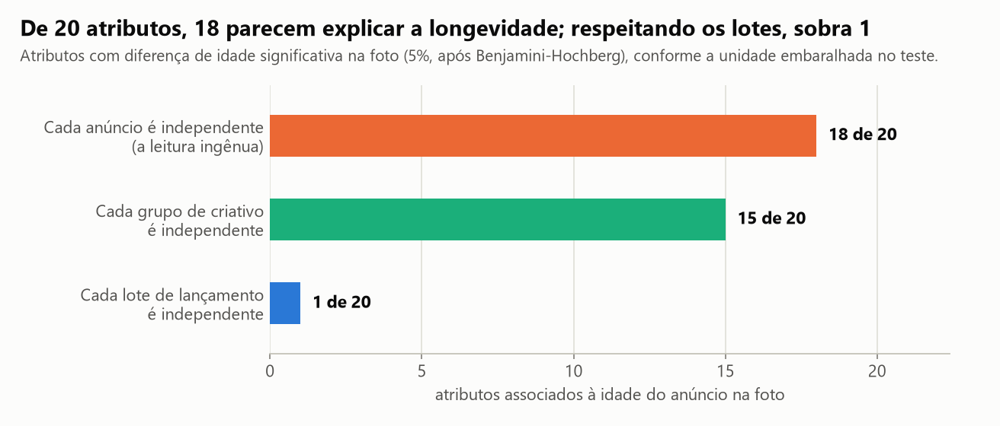
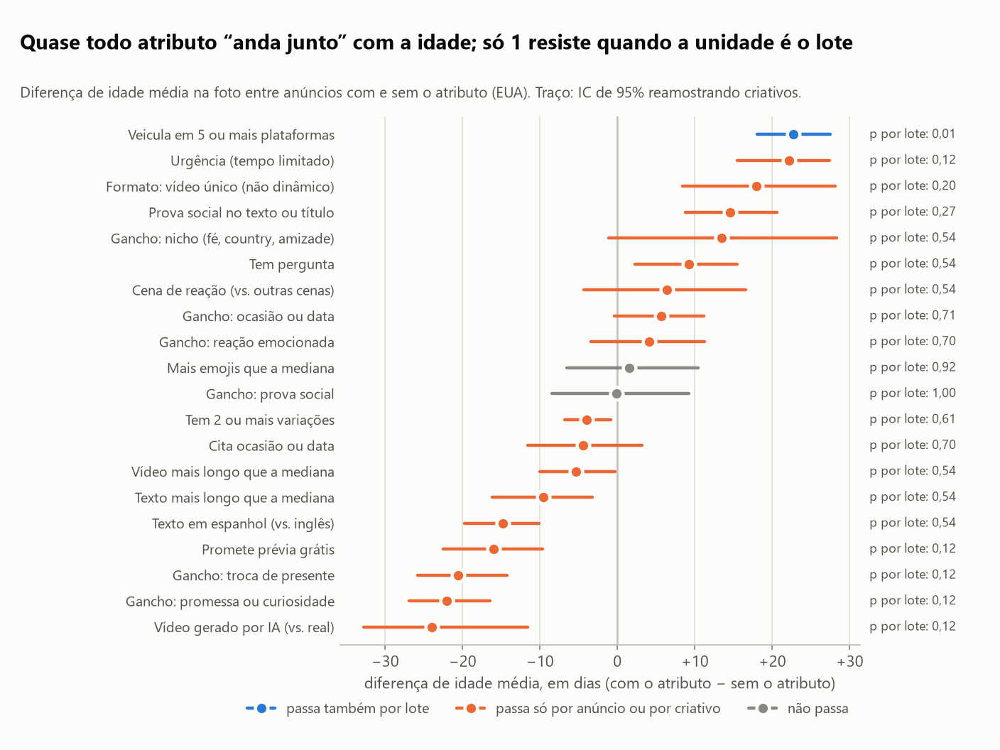
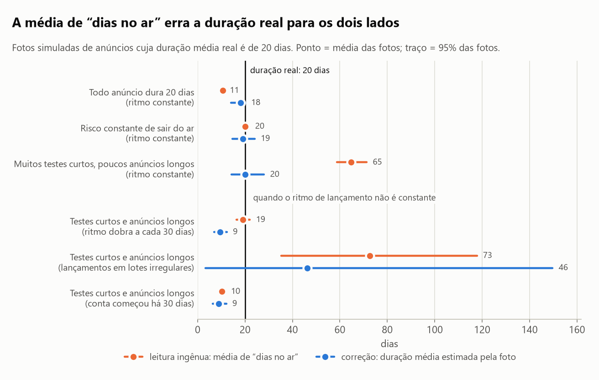
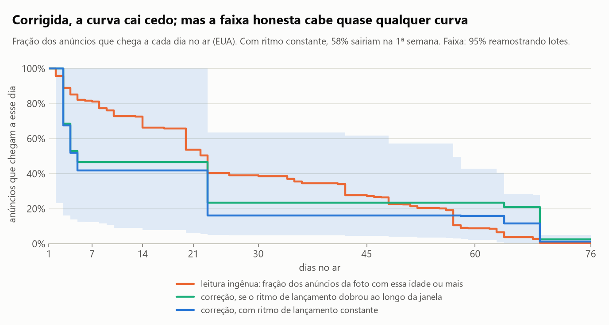
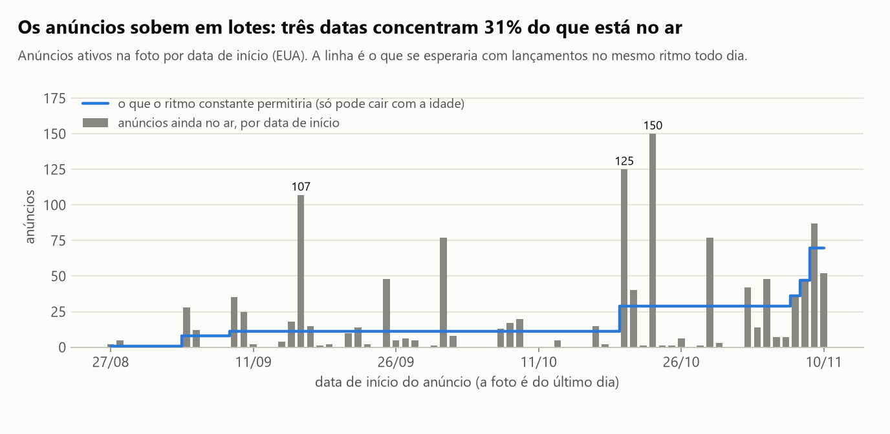
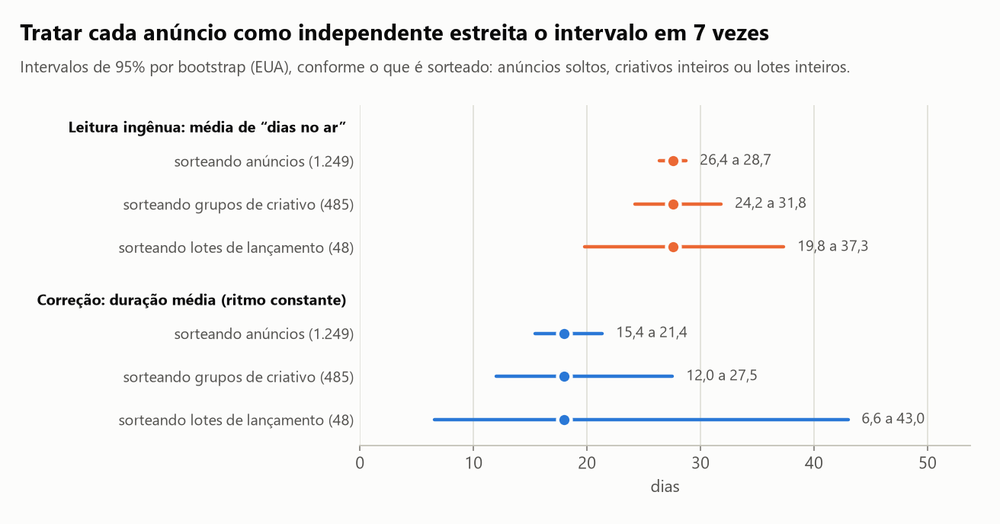

# O que o líder do mercado mantém no ar, e o que isso diz (e não diz) sobre o que funciona?

Dá para descrever com segurança o que o concorrente líder mantém no ar. Não dá para dizer o que funciona.
De 20 atributos de anúncio, **18** parecem ligados à longevidade quando cada anúncio conta como uma observação
independente, e sobra **1** quando a unidade é o lote de lançamento (e esse um é configuração de campanha, não
escolha criativa). A média de 27,6 "dias no ar" também não é a duração de um anúncio: corrigido o viés da foto, a
estimativa é de 18 dias, com intervalo honesto de 7 a 43.

O contexto: este estudo nasceu da preparação do lançamento de um produto meu, de música personalizada como
presente. Coletei na Biblioteca de Anúncios da Meta os anúncios **ativos** do concorrente líder do segmento em 10/11/2026:
1.342 anúncios (1.249 nos Estados Unidos e 93 no Brasil), em 574 criativos distintos. Todo gestor de tráfego lê
essa biblioteca do mesmo jeito: "este anúncio está há 70 dias no ar, então funciona". Este estudo testa o quanto
essa leitura se sustenta.

## Em 30 segundos

- **A biblioteca é uma foto dos anúncios vivos, não um histórico.** "Dias no ar" é a idade do anúncio, não a duração
  dele; anúncio longo tem mais chance de aparecer na foto; quem já saiu do ar é invisível.
- **Numa simulação com resposta conhecida** (duração média real de 20 dias), a média de "dias no ar" dá 10,5, 20,0
  ou 64,8 dias, conforme a forma da distribuição das durações. O erro vai de −47% a +224%, e a foto não diz de que
  lado se está.
- **A correção existe, mas depende de uma hipótese que a foto não confere.** Com ritmo de lançamento constante, a
  duração média nos EUA seria de 18,0 dias e 76% dos anúncios lançados na janela já teriam saído do ar. Se o ritmo
  dobrou na janela, 22,4 dias; se quadruplicou, 28,6.
- **Os anúncios sobem em lotes**, e isso muda a conta da incerteza: o intervalo que trata cada anúncio como
  independente (26,4 a 28,7 dias) é 7 vezes mais estreito que o que sorteia lotes inteiros (19,8 a 37,3).
- **Idade na foto é calendário de lançamento.** 18 de 20 atributos "explicam" a idade do anúncio; por lote, 1.
- **Para quem vai lançar:** "dias no ar" serve para escolher referência de formato, não como evidência de
  desempenho. O que funciona só o teste próprio responde, e a pergunta sobre o concorrente tem solução barata: uma
  foto da biblioteca por semana.

## Os achados

### 1. Quase todo atributo "explica" a longevidade, até a unidade ser a certa



Para cada um de 20 atributos (formato, tipo de cena, vídeo real ou gerado, categoria do gancho, elementos do texto),
comparei a idade média dos anúncios com e sem o atributo, nos EUA, e testei a diferença por permutação com ajuste de
Benjamini-Hochberg. O teste foi feito três vezes, mudando só o que é embaralhado: anúncios soltos, grupos de
criativo inteiros ou lotes de lançamento inteiros. O número de atributos significativos a 5% cai de 18 para 15 e
para 1.



| Atributo | Anúncios com | Lotes com | Diferença de idade (dias) | IC 95% (por criativo) | p ajustado por anúncio | por criativo | por lote |
|---|---|---|---|---|---|---|---|
| Veicula em 5 ou mais plataformas | 608 | 29 | +22,7 | 18,1 a 27,5 | <0,001 | <0,001 | 0,010 |
| Urgência (tempo limitado) | 263 | 18 | +22,2 | 15,5 a 27,4 | <0,001 | <0,001 | 0,12 |
| Formato: vídeo único (não dinâmico) | 92 | 13 | +17,9 | 8,4 a 28,1 | <0,001 | <0,001 | 0,20 |
| Prova social no texto ou título | 626 | 33 | +14,6 | 8,8 a 20,7 | <0,001 | <0,001 | 0,27 |
| Gancho: nicho (fé, country, amizade) | 37 | 6 | +13,5 | −1,2 a 28,3 | <0,001 | 0,013 | 0,54 |
| Tem pergunta | 82 | 9 | +9,2 | 2,3 a 15,5 | <0,001 | <0,001 | 0,54 |
| Cena de reação (vs. outras cenas) | 447 | 19 | +6,4 | −4,3 a 16,6 | 0,004 | 0,23 | 0,54 |
| Gancho: ocasião ou data | 73 | 9 | +5,7 | −0,4 a 11,2 | 0,030 | 0,018 | 0,71 |
| Gancho: reação emocionada | 582 | 32 | +4,1 | −3,4 a 11,3 | 0,001 | 0,23 | 0,70 |
| Mais emojis que a mediana | 452 | 25 | +1,5 | −6,6 a 10,4 | 0,25 | 0,68 | 0,92 |
| Gancho: prova social | 448 | 24 | −0,1 | −8,5 a 9,3 | 0,95 | 0,95 | >0,99 |
| Tem 2 ou mais variações | 806 | 32 | −3,9 | −6,8 a −0,8 | 0,002 | 0,013 | 0,61 |
| Cita ocasião ou data | 133 | 13 | −4,4 | −11,6 a 3,2 | 0,024 | 0,40 | 0,70 |
| Vídeo mais longo que a mediana | 537 | 41 | −5,3 | −10,0 a −0,3 | <0,001 | 0,038 | 0,54 |
| Texto mais longo que a mediana | 606 | 35 | −9,6 | −16,1 a −3,3 | <0,001 | <0,001 | 0,54 |
| Texto em espanhol (vs. inglês) | 222 | 7 | −14,8 | −19,8 a −10,1 | <0,001 | <0,001 | 0,54 |
| Promete prévia grátis | 622 | 26 | −16,0 | −22,5 a −9,7 | <0,001 | <0,001 | 0,12 |
| Gancho: troca de presente | 50 | 7 | −20,6 | −25,8 a −14,2 | <0,001 | 0,006 | 0,12 |
| Gancho: promessa ou curiosidade | 52 | 9 | −22,0 | −26,9 a −16,5 | <0,001 | <0,001 | 0,12 |
| Vídeo gerado por IA (vs. real) | 33 | 6 | −24,0 | −32,8 a −11,6 | <0,001 | 0,006 | 0,12 |

O que essa associação pode e não pode significar:

- **Idade na foto é a data em que o lote subiu.** Os 222 anúncios em espanhol entraram em 7 datas, todas nos últimos
  22 dias. A "idade média 15 dias menor" deles diz que o anunciante começou o espanhol há pouco, não que anúncio em
  espanhol dura menos.
- **O único atributo que resiste é uma configuração de campanha.** Em quantas plataformas o anúncio veicula muda de
  um lote para o outro: é o anunciante mudando a forma de subir campanha ao longo do tempo.
- **Não passar por lote não prova que o atributo é irrelevante.** São 48 lotes; o teste tem pouco poder. O que ele
  mostra é que a foto não tem informação para decidir.
- **Idade não é desempenho.** Não há dado de gasto nem de resultado, e um anúncio pode ficar no ar por inércia.

### 2. A média de "dias no ar" erra a duração real para os dois lados



Simulei anúncios com duração conhecida (média de 20 dias em todos os cenários), tirei uma "foto" e comparei a
leitura ingênua e a correção com a verdade. Cada linha resume 150 fotos, cada uma com algo entre 550 e 1.700 anúncios.

| Como os anúncios duram | Ritmo de lançamento | Leitura ingênua | Erro | Correção (95% das fotos) | Erro | Duração real de quem aparece na foto |
|---|---|---|---|---|---|---|
| Todo anúncio dura 20 dias | Constante | 10,5 | −47% | 18,1 (14 a 20) | −9% | 20 |
| Risco constante de sair do ar | Constante | 20,0 | 0% | 19,0 (15 a 24) | −5% | 39 |
| Muitos testes curtos, poucos anúncios longos | Constante | 64,8 | +224% | 20,0 (14 a 28) | 0% | 129 |
| Muitos testes curtos, poucos anúncios longos | Dobra a cada 30 dias | 19,2 | −4% | 9,4 (7 a 12) | −53% | 69 |
| Muitos testes curtos, poucos anúncios longos | Em lotes irregulares | 72,6 | +263% | 46,2 (3 a 150) | +131% | 140 |
| Muitos testes curtos, poucos anúncios longos | Conta começou há 30 dias | 10,3 | −48% | 9,0 (6 a 12) | −55% | 56 |

Com ritmo constante, a teoria prevê o que a foto mostra: idade média = `E[D(D+1)] / (2·E[D])`. Se todo anúncio dura
o mesmo, a foto mostra metade. Se há muitos testes curtos e poucos anúncios longos, mostra mais que o triplo. A
última coluna é o paradoxo da inspeção: os anúncios que aparecem na foto duram, em média, 129 dias num mundo em que o
anúncio típico dura 20.

A correção acerta com ritmo constante (com um viés pequeno para baixo, de até 9%) e erra sem ele. No cenário em que o
ritmo dobra a cada 30 dias, a leitura ingênua chega mais perto (−4%) que a correção (−53%): dois erros opostos se
cancelam por coincidência. Com lotes irregulares, uma foto sozinha dá de 3 a 150 dias. As 12 combinações estão em
`reports/resultados.json`.

### 3. Nos dados reais: 27,6 dias na leitura ingênua, 18 na correção, e uma faixa que cabe quase tudo



Com ritmo de lançamento constante, a distribuição das idades na foto é proporcional à curva de sobrevivência. O
estimador (Grenander, por regressão isotônica) dá, nos EUA:

| | Leitura ingênua | Correção (ritmo constante) |
|---|---|---|
| Duração típica de um anúncio | 27,6 dias (mediana 22) | 18,0 dias |
| Anúncios que chegam ao 8º dia | 77% | 42% |
| Anúncios que chegam ao 31º dia | 39% | 16% |
| Anúncios lançados nos 76 dias da janela | 1.249 (os que se veem) | 5.282, dos quais 76% já saíram do ar |

A leitura corrigida conta uma história plausível de teste de criativos: a maioria sai na primeira semana e quem passa
de três semanas fica. Mas a faixa azul (95%, sorteando lotes) vai de 5% a 64% no 31º dia. E toda a curva depende do
ritmo, que a foto não mostra.

### 4. O próprio dado contradiz o ritmo constante



Nos EUA há lançamento em 48 dos 76 dias, mas três datas concentram 31% do que está no ar e 23% dos anúncios têm 7
dias ou menos. O índice de dispersão das contagens por dia em torno da curva ajustada é 39,7 (seria perto de 1 com
lançamentos independentes). No Brasil a página tem 20 dias e 4 datas de lançamento, uma delas com 80% dos anúncios:
a "média de 9,9 dias no ar" é só o calendário de quando a conta estreou.

O que a foto identifica é o produto `ritmo(a) × sobrevivência(a)`. A mesma foto, lida com outras hipóteses de ritmo:

| Ritmo hoje ÷ ritmo no início da janela | Duração média (dias) | IC 95% por lote | Lançados em 76 dias | Chegam ao dia 31 |
|---|---|---|---|---|
| 0,25 (o ritmo caiu) | 12,4 | 4,8 a 32,0 | 11.348 | 8% |
| 0,5 | 14,7 | 5,6 a 36,3 | 7.589 | 11% |
| 1 (constante) | 18,0 | 6,6 a 43,0 | 5.282 | 16% |
| 2 | 22,4 | 7,9 a 51,2 | 3.830 | 23% |
| 4 | 28,6 | 9,7 a 61,7 | 2.890 | 34% |
| 8 (o ritmo subiu muito) | 37,0 | 11,9 a 68,4 | 2.264 | 49% |

A coleta foi feita 45 dias antes do Natal, num negócio de presentes: ritmo subindo é o cenário mais provável, e nele a
correção de 18 dias está subestimada.

### 5. Anúncios não são independentes: o intervalo certo sorteia blocos



| O que o bootstrap sorteia | Blocos | IC 95% da leitura ingênua | IC 95% da correção | Vezes mais largo que o ingênuo |
|---|---|---|---|---|
| Anúncios soltos | 1.249 | 26,4 a 28,7 | 15,4 a 21,4 | 1,0 e 1,0 |
| Grupos de criativo inteiros | 485 | 24,2 a 31,8 | 12,0 a 27,5 | 3,2 e 2,6 |
| Lotes de lançamento inteiros | 48 | 19,8 a 37,3 | 6,6 a 43,0 | 7,4 e 6,1 |

Qual deles merece confiança? Na simulação a verdade é conhecida, então contei em quantas fotos o intervalo de 95% a
contém (150 fotos por ritmo):

| Ritmo na simulação | Unidade sorteada | Cobertura do IC da leitura ingênua | Cobertura do IC da correção |
|---|---|---|---|
| Constante | Anúncio | 76% | 76% |
| Constante | Grupo de criativo | 97% | 94% |
| Constante | Lote de lançamento | 100% | 100% |
| Em lotes irregulares | Anúncio | 23% | 5% |
| Em lotes irregulares | Grupo de criativo | 29% | 6% |
| Em lotes irregulares | Lote de lançamento | 79% | 67% |

Sortear grupos de criativo conserta o intervalo quando o ritmo é constante. Quando os lançamentos vêm em lotes, como
nos dados reais, nem isso basta: o intervalo por criativo cobre a verdade em menos de 30% das fotos, e o intervalo por
lote, o menos errado, fica entre 67% e 79%. O "7 a 43 dias" é, portanto, otimista.

### 6. O que o concorrente mantém no ar (isto a foto mostra bem)

| | Brasil | Estados Unidos |
|---|---|---|
| Anúncios ativos | 93 | 1.249 |
| Criativos distintos | 89 | 485 |
| Anúncios por criativo (média; máximo) | 1,04; 2 | 2,58; 62 |
| Criativos com um anúncio só | 96% | 38% |
| Anúncios nos 10% de criativos mais usados | 14% | 32% |
| Gini dos anúncios por criativo | 0,04 | 0,40 |
| Textos distintos; anúncios no texto mais usado | 2; 87% | 58; 16% |
| Datas de lançamento; maior lote | 4; 80% dos anúncios | 48; 12% dos anúncios |
| Formato dinâmico (várias combinações por anúncio) | 100% | 92% (89% a 94%) |
| Duração mediana do vídeo | 63 s | 61 s |
| Vídeo real, entre os classificados | 94% (88% a 98%) | 93% (86% a 99%) |
| Cena de reação, entre os classificados | 92% (87% a 97%) | 81% (71% a 89%) |
| Gancho de reação emocionada | 100% | 47% (39% a 53%) |
| Gancho de prova social | 0% | 36% (29% a 44%) |
| Promete prévia grátis | 87% (79% a 94%) | 50% (43% a 57%) |
| Prova social no texto ou título; na descrição | 0%; 0% | 50%; 88% |
| Urgência ("tempo limitado") | 0% | 21% (16% a 26%) |
| Cita preço | 0% | 0% |
| Cita Natal | 0% | 0% |
| Idiomas | português | inglês 79%, espanhol 18%, chinês 3% |

Intervalos de 95% sorteando grupos de criativo. A classificação do vídeo cobre todos os anúncios do Brasil e 44% dos
dos EUA.

A operação madura (EUA) reaproveita criativo: 2,6 anúncios por vídeo, com os mesmos textos girando em dezenas de
vídeos. A operação nova (Brasil) é um teste de vídeo puro: 89 vídeos, 2 textos, todos no mesmo gancho (alguém ouve a
própria música e se emociona), sem prova social, sem urgência. Nos dois países, nenhum anúncio cita preço e nenhum
cita Natal, a 45 dias do Natal.

Um sinal um pouco melhor que a idade é o relançamento: o anunciante escolher de novo, há pouco, um criativo que já
tem faz tempo. Dos 165 criativos americanos com 30 dias ou mais, só 7 reaparecem num anúncio lançado nos últimos 14
dias; dos 20 mais antigos, nenhum. Os outros 158 estão no ar sem que ninguém tenha mexido neles. Pode ser porque
funcionam, pode ser inércia: a foto não distingue.

### 7. Ponte para a decisão

Categoria do gancho (a abertura do texto, pelas regras de [`texto.py`](src/anuncios_concorrente/texto.py)) nos
anúncios do concorrente:

| Categoria do gancho | EUA: anúncios | EUA: anúncios com 30 dias ou mais | Brasil: anúncios |
|---|---|---|---|
| Reação emocionada | 47% | 59% | 100% |
| Prova social | 36% | 28% | 0% |
| Ocasião ou data | 6% | 7% | 0% |
| Troca de presente | 4% | 0% | 0% |
| Promessa ou curiosidade | 4% | 0% | 0% |
| Nicho (fé, country, amizade) | 3% | 6% | 0% |
| Oferta ou objeção | 1% | 0% | 0% |
| Preço | 0% | 0% | 0% |

Duas categorias dominam o concorrente: reação emocionada e prova social somam 82% dos anúncios americanos e 100%
dos brasileiros. Ocasião, oferta ou objeção e preço, juntas, ficam em 6% nos EUA e não aparecem no Brasil. A coluna
de anúncios mostra o que o líder lança; a de 30 dias ou mais, o que ele lançou antes; nenhuma mede resultado. Seguir
a mistura do líder ou apostar no que ele deixa vazio é decisão que esta tabela não toma.

O que testar, como hipótese e não como conclusão deste estudo:

1. **O ângulo próprio contra o ângulo dominante do líder, com a mesma verba por criativo.** É a única comparação que
   diz se apostar diferente se paga; a biblioteca não diz.
2. **Uma foto da biblioteca por semana.** Com duas fotos já se vê quem saiu do ar; com seis, a curva de sobrevivência
   deixa de depender da hipótese de ritmo, e "o que sobrevive" vira pergunta com resposta.
3. **Data e motivo de cada pausa na própria conta.** É o dado que falta no concorrente e o único que liga duração a
   desempenho.

## Como foi feito

1. **Extrato anonimizado.** [`scripts/extrair_dados.py`](scripts/extrair_dados.py) lê a coleta original e grava em
   `data/` um anúncio por linha, sem nome, página, domínio, link, id, texto ou mídia. Os anúncios que compartilham
   um vídeo repetido formam um grupo de criativo.
2. **Atributos do texto por regras.** Comprimento, emojis, preço, prova social, urgência, ocasião, pergunta, prévia
   grátis e a categoria do gancho saem de listas de expressões em quatro idiomas, em
   [`texto.py`](src/anuncios_concorrente/texto.py).
3. **Simulação de resposta conhecida.** Anúncios lançados ao longo de 800 dias, com três formas de duração e quatro
   ritmos de lançamento; criativos com mais de um anúncio, que saem do ar juntos em 70% dos casos.
4. **Estimador.** Em dias inteiros, o número esperado de anúncios com idade `a` é `taxa × ritmo(a) × S(a)`. Com
   ritmo constante, `S(a) = p(a) / p(1)` e a duração média é `1 / p(1)`, com `p` estimada como a melhor sequência
   não crescente (regressão isotônica, implementada em [`sobrevivencia.py`](src/anuncios_concorrente/sobrevivencia.py)
   e conferida contra o scikit-learn). Com outro ritmo, a mesma regressão com pesos.
5. **Incerteza por blocos.** Bootstrap sorteando anúncios, grupos de criativo ou lotes; cobertura medida na simulação.
6. **Associação com a idade.** Diferença de idade média, intervalo por bootstrap de criativos, permutação em três
   níveis e ajuste de Benjamini-Hochberg em cada nível.
7. **Ponte para a decisão.** A mistura de categorias de gancho do concorrente e o que testar a partir dela.

### Os dados

Fonte: Biblioteca de Anúncios da Meta, busca pública de anúncios ativos de um anunciante, coletada por mim em
10/11/2026 (Brasil e Estados Unidos). A biblioteca é pública; o extrato deste repositório traz só atributos
derivados e está sob a mesma licença MIT do código. Colunas de `data/anuncios.csv`:

| Coluna | O que é |
|---|---|
| `anuncio`, `grupo_criativo`, `texto_id`, `pagina` | rótulos embaralhados (sem volta para o original) do anúncio, do grupo de vídeos repetidos, do texto e da página |
| `pais`, `inicio`, `dias_no_ar` | país da busca, data de início e idade na data da coleta |
| `dias_desde_ultimo_registro` | dias entre a última data registrada do anúncio e a coleta (0 na maioria) |
| `formato`, `n_plataformas`, `variacoes`, `tem_video`, `duracao_video_s` | formato, número de plataformas, variações e duração do vídeo |
| `tipo_criativo`, `cena` | classificação do vídeo: real, gerado por IA ou misto; tipo de cena |
| `idioma`, `comprimento_texto`, `n_emojis` | derivados do texto principal |
| `tem_preco`, `tem_prova_social`, `tem_urgencia`, `tem_ocasiao`, `cita_natal`, `tem_pergunta`, `tem_previa_gratis` | presenças no texto ou no título |
| `descricao_tem_prova_social` | prova social no campo de descrição |
| `categoria_gancho` | categoria da abertura do texto |

`data/coleta.json` guarda a data e as contagens da coleta.

## Comparação com a alternativa simples

A alternativa simples é a leitura que o mercado faz: ordenar por "dias no ar", tratar a média como duração típica e
cada anúncio como uma observação independente.

| Pergunta | Leitura ingênua | Este estudo |
|---|---|---|
| Quanto dura um anúncio do concorrente (EUA)? | 27,6 dias, IC de 26,4 a 28,7 | 18,0 dias com ritmo constante, IC por lote de 6,6 a 43,0; de 12,4 a 37,0 conforme o ritmo |
| Quantos anúncios ele lançou em 76 dias? | 1.249, os que se veem | 5.282 com ritmo constante (IC por lote de 1.964 a 15.808); de 2.264 a 11.348 conforme o ritmo |
| Quantos de 20 atributos se associam à idade? | 18 | 15 por criativo, 1 por lote |
| Na simulação com ritmo constante, o IC de 95% cobre a verdade em | 76% das fotos | 94% a 97% (por criativo) |
| Na simulação com lotes, o IC de 95% cobre a verdade em | 5% a 23% das fotos | 67% a 79% (por lote) |
| Na simulação, erro da duração estimada | de −47% a +224% com ritmo constante | de −9% a 0% com ritmo constante; de −55% a +131% sem ele |

A correção não "vence" a leitura ingênua. Com ritmo constante ela acerta e a ingênua não. Sem ritmo constante as
duas erram, e num dos cenários simulados a ingênua chega mais perto por coincidência. O ganho deste estudo não é um
número melhor: é saber o tamanho da incerteza e o que a foto não pode responder.

## Onde este estudo falha

- **Uma foto só.** A foto identifica o produto `ritmo × sobrevivência`, nunca os dois separados. Toda duração e toda
  curva daqui valem sob uma hipótese de ritmo que os dados não conferem, e que os lotes contradizem.
- **O intervalo por lote ainda é estreito demais.** Na simulação com lotes ele cobre a verdade em 67% a 79% das
  fotos, não em 95%. Não achei, com uma foto, intervalo que cubra o prometido.
- **O estimador tem viés para baixo.** A duração corrigida usa o maior trecho inicial das contagens; em amostra
  finita isso puxa a duração para baixo (até −9% na simulação com ritmo constante).
- **Pouco poder por lote.** São 48 lotes nos EUA e 4 no Brasil. Atributos que entraram em 6 ou 7 lotes não têm como
  passar no teste. "Não significativo" aqui quer dizer "a foto não decide".
- **Brasil não é estimável.** Com 4 datas de lançamento e 20 dias de conta, não calculei sobrevivência nem testei
  atributos; o Brasil entra só na descrição.
- **Classificação do vídeo incompleta e enviesada.** Cobre 44% dos anúncios dos EUA: 39% dos que têm até 30 dias, 67%
  dos de 31 a 60 e 3% dos de mais de 60. Os testes de "IA ou real" e de "cena" valem para esse recorte.
- **Regras de texto são minhas.** A categoria do gancho vem de listas de expressões e de uma ordem de prioridade que
  eu escolhi; são 58 textos distintos nos EUA e 2 no Brasil. Outra regra mudaria as fatias.
- **Grupo de criativo depende do agrupamento da coleta.** Vídeos iguais foram agrupados por impressão digital com um
  limiar fixo; as versões 9:16 e 4:5 do mesmo vídeo foram unidas por aparecerem no mesmo anúncio; anúncios só de
  imagem foram agrupados por texto idêntico.
- **Um campo de significado incerto.** 285 anúncios americanos têm a última data registrada anterior à coleta, embora
  constem como ativos. Sem eles, a duração corrigida cai para 13,9 dias.
- **Um anunciante, um dia, perto do Natal.** Nada aqui generaliza para o mercado, e a época do ano torna o ritmo
  constante ainda menos plausível.
- **Sem gasto e sem resultado.** A biblioteca não mostra verba, impressões nem vendas. Nenhuma tabela deste estudo
  mede desempenho.

## Como rodar

Pré-requisito: [`uv`](https://docs.astral.sh/uv/getting-started/installation/).

```bash
uv sync
uv run python scripts/rodar_analise.py   # regera reports/resultados.json e as figuras (1 a 2 minutos)
uv run pytest                            # 59 testes
```

O estudo roda a partir do extrato em `data/`. Não há `baixar_dados.py`: a coleta original é privada, e
`scripts/extrair_dados.py` só serve a quem tem a pasta dela (`uv run python scripts/extrair_dados.py
PASTA_DA_COLETA`). Cada extração embaralha os rótulos de novo.

O notebook [`analise.ipynb`](analise.ipynb) conta a história completa, com as tabelas.

```text
├── analise.ipynb
├── data/                         # extrato anonimizado: anuncios.csv, coleta.json
├── src/anuncios_concorrente/
│   ├── texto.py                  # regras dos atributos de texto e da categoria do gancho
│   ├── sobrevivencia.py          # regressão isotônica, estimador pela foto, teoria e simulação
│   ├── estatistica.py            # bootstrap e permutação por blocos, Benjamini-Hochberg, Gini
│   ├── analise.py                # cada tabela do estudo
│   ├── dados.py, graficos.py, estilo.py
├── scripts/                      # extrair_dados.py, rodar_analise.py
├── tests/                        # 59 testes (pytest), com um guarda do que não pode ir a público
└── reports/                      # resultados.json e figuras
```

---

Hélcio Venâncio · [github.com/ghitflux](https://github.com/ghitflux) · Licença MIT

## Como este estudo foi feito

Este estudo foi construído com assistência de IA (Claude Code, da Anthropic), usada como par de programação.
Declaro a divisão do trabalho porque ela importa para quem avalia:

- **Meu:** o produto e o problema (o Dedico Songs é meu: desenvolvi o produto, o plano de marketing, o plano de
  tráfego e o benchmark de concorrentes), a coleta da biblioteca de anúncios que serve de dado a este estudo, a
  pergunta (o que dá para concluir dos anúncios que o concorrente mantém no ar?), a leitura crítica dos resultados
  e a decisão do que publicar e do que declarar como limitação.
- **Com o assistente:** a escolha do método estatístico, a implementação do código, dos testes e dos gráficos, e a
  redação, que revisei.
- **Como conferir:** todo número deste README sai de `reports/resultados.json`, gerado por
  `scripts/rodar_analise.py` a partir do extrato anonimizado em `data/`. Os testes em `tests/` conferem os
  estimadores contra simulações de resposta conhecida.

É o mesmo jeito que trabalho nos sistemas que entrego: a IA acelera a implementação, e a responsabilidade pelo que
está escrito aqui é minha.

## Summary (English)

Every media buyer reads a competitor's ad library the same way: "this ad has been running for 70 days, so it works".
This study tests that reading on a single-day snapshot of 1,342 active ads (574 distinct creatives) from the leading
competitor of a personalized-song gift product about to launch. A snapshot of live ads is length-biased and shows
ages, not lifetimes: in a known-answer simulation with a true mean lifetime of 20 days, the naive mean of "days
running" returns anything from 10.5 to 64.8 days. Under a constant launch rate the age density is proportional to
the survival function, so a Grenander (isotonic) estimator implemented in NumPy recovers the curve; on the real data
it gives 18.0 days against the naive 27.6, but the answer moves from 12 to 37 days with the assumed launch rate, and
the data itself shows ads launched in batches (dispersion index of 40). Uncertainty is resampled by block: the
interval that treats ads as independent is 7 times narrower than the one that resamples launch batches, and in
simulation only block resampling approaches nominal coverage. Of 20 ad attributes, 18 are "significantly" associated
with ad age under ad-level permutation, 15 under creative-level and 1 under batch-level permutation with
Benjamini-Hochberg correction: age in the snapshot is mostly the launch calendar. The study closes by describing
the competitor's mix of hook categories and by listing what to test, as hypotheses. Data is anonymized; code, tests and notebook are in Portuguese.
